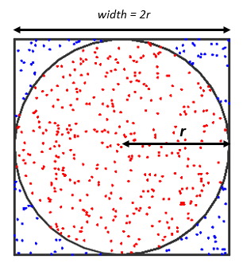

# Exam Assignment 21.10.2026

## Task 1
> Select one slide from the lecture, research more about the topic, and report on it.

**Slide 21: "Estimating π using Monte Carlo"**

A Monte Carlo algorithm is a randomized algorithm whose output may be incorrect with a small, but non-zero, probability. However, it has a deterministic running time.

The advantage of such algorithms is that they are often easier to implement than their exact counterparts. Additionally, since random predictions are usually independent of each other, they can easily be parallelized and are highly scalable. Another advantage of Monte Carlo algorithms is that the runtime is predictable, i.e., the number of operations, which allows users to choose between an early estimation and a longer runtime with higher precision. 

The obvious disadvantage of this group of randomized algorithms is that the solution is a statistical approximation, not an exact one. Also, randomness means that prediction quality can vary. Poor randomness can introduce biases into the data. For example, using one random seed across all threads when parallelizing can cause this issue.

The idea behind estimating π using Monte Carlo is to have a unit circle with radius $r=1$ inside a square with an edge length $l=2r$. Then, random points are generated by assigning random coordinates, $x \in [0,1]$ & $y \in [0,1]$, to each point. An illustration of some sample points:

[3]

We know that the area of the circle is $\pi r^2$. We know that the area of the square is $(2r)^2 = 4r^2$. The fraction of both areas gives: \
$\frac{\text{area of the circle}}{\text{area of the square}} = \frac{\pi r^2}{4r^2} = \frac{\pi}{4}$

In other words, the ratio of the number of points generated inside the circle to the total number of points generated inside the square is $\frac{\pi}{4}$. Multiplied by $4$ we get $\pi$.

Sources:
1. https://en.wikipedia.org/wiki/Monte_Carlo_algorithm
2. https://www.geeksforgeeks.org/dsa/estimating-value-pi-using-monte-carlo/
3. https://www.101computing.net/estimating-pi-using-the-monte-carlo-method/

## Task 2
> Read Chapter 1 from Computer Systems: A Programmer’s Perspective.
> - http://csapp.cs.cmu.edu/2e/ch1-preview.pdf
> - Discuss two things you find particularly interesting.

Read time: ~1h 30min

Discussions based on previous completed lectures: Parallel Computing I (WS23), Parallel Computing II (SS24), Efficient Machine Learning (SS24), Machine Learning Compilers (SS25)

### Caches Matter

Section 1.5 of the first chapter discusses the importance of caches in the `hello` program. It describes (together with section 1.6) how data is loaded from and into the different levels of a computer's memory hierarchy. This hierarchy ranges from registers to L1, L2, and L3 caches, then to main memory, and finally to disk and remote storage. Due to physical limitations, faster memory is smaller in practice. Therefore, large storage comes with the trade-off of being slower.

One of the most important concepts in designing efficient programs is **locality**. Locality consists of two types: temporal and spatial locality. Temporal locality means that if a memory location is accessed, it will tend to be referenced or used again in the near future. Spatial locality means that if a memory location is referenced, nearby memory locations will tend to be referenced in the near future.

The chapter falls short on the topic of cache-aware and cache-oblivious algorithms. Cache-aware algorithms require knowledge of the hardware, such as the cache line and total cache sizes. These algorithms can be fine-tuned for specific hardware but may need to be modified for different systems. In contrast, cache-oblivious algorithms optimize cache performance without considering hardware parameters. They try to achieve good cache efficiency across multiple levels of the memory hierarchy, which makes them more portable but potentially more difficult to implement.

### Concurrency and Parallelism

Section 1.9.1 discusses instruction-level parallelism, which enables processors to execute multiple instructions simultaneously. **Pipelining** is a technique for achieving instruction-level parallelism by dividing instruction execution into multiple stages. Each stage can process a different instruction simultaneously, allowing multiple instructions to be processed concurrently.

Furthermore, the chapter discusses SIMD (single instruction, multiple data) as a form of parallelism. SIMD enables a single instruction to be executed on multiple data points simultaneously. For example, a 128-bit SIMD register can store a vector of four 32-bit floating-point numbers, and a single instruction can operate on all four elements simultaneously.

Modern processors provide SIMD instruction set extensions, such as SVE (Scalable Vector Extension), which offers register sizes of up to 2048 bits. SVE enables more flexible and efficient processing of large datasets. There is also the more specialized SME (Scalable Matrix Extension), an extension for Arm processors that can provide higher throughput for matrix operations. However, that topic exceeds the scope of this chapter.

## Task 3 (optional)
> Do the coding warmup on slide 19. (optional)

Results of task 3 can be found in the [task_03](task_03) folder. \
Results of task 4 can be found in the [task_04](task_04) folder.

### Task 3.1
> Compile and run the programs of slides 12 and 14

**hello.cpp**
```sh
$ g++ -fopenmp hello.cpp -o hello.exe
$ OMP_NUM_THREADS=4 ./hello.exe      
Hello from thread Hello from thread Hello from thread 0Hello from thread 1
2
3

$ OMP_NUM_THREADS=8 ./hello.exe     
Hello from thread Hello from thread Hello from thread Hello from thread 035Hello from thread 1Hello from thread Hello from thread 
2

7

Hello from thread 6
4

```

**hello_simple.cpp**
```sh
$ g++ -fopenmp hello_simple.cpp -o hello_simple.exe
$ ./hello_simple.exe                               
Hello World!
Hello World!
Hello World!
Hello World!
```

**generated.cpp**
```sh
$ g++ -fopenmp generated.cpp -o generated.exe      
$ ./generated.exe                            
Hello World!
Hello World!
Hello World!
Hello World!
```

### Task 3.2
> Create a parallel version of the π program (slide 16)

Added `#pragma omp parallel for reduction(+:sum)` to the for loop in [pi_numerical_integration_parallel.cpp](task_03/pi_numerical_integration_parallel.cpp)
- `parallel for`: Distributes iterations among threads
- `reduction(+:sum)`: Each thread gets its own copy of `sum` (initialized to 0.0) and at the end of the parallel region, all copies are aggregated into a single value using the `+` operator

### Task 3.3
> Watch the times your implementation needs with different numbers of threads

```sh
# sequential version
$ g++ -fopenmp pi_numerical_integration.cpp -o pi_numerical_integration.exe
$ ./pi_numerical_integration.exe 
pi with 100000000 steps is 3.1415926535904264 in 0.16751 seconds

# parallel version
$ g++ -fopenmp pi_numerical_integration_parallel.cpp -o pi_numerical_integration_parallel.exe
$ OMP_NUM_THREADS=1 ./pi_numerical_integration_parallel.exe
pi with 100000000 steps is 3.1415926535904264 in 0.173741 seconds

$ OMP_NUM_THREADS=2 ./pi_numerical_integration_parallel.exe
pi with 100000000 steps is 3.1415926535899099 in 0.0992854 seconds

$ OMP_NUM_THREADS=4 ./pi_numerical_integration_parallel.exe
pi with 100000000 steps is 3.1415926535896825 in 0.0491974 seconds

$ OMP_NUM_THREADS=8 ./pi_numerical_integration_parallel.exe
pi with 100000000 steps is 3.1415926535898158 in 0.0365358 seconds
```

The parallel version is faster than the sequential version, and the speedup increases with the tested number of threads.

### Task 3.4
> Try compiling with optimization flag -Ofast

```sh
# sequential version
$ g++ -fopenmp -Ofast pi_numerical_integration.cpp -o pi_numerical_integration.exe
$ ./pi_numerical_integration.exe  
pi with 100000000 steps is 3.1415926535900236 in 0.0604126 seconds

# parallel version
$ g++ -fopenmp -Ofast pi_numerical_integration_parallel.cpp -o pi_numerical_integration_parallel.exe
$ OMP_NUM_THREADS=1 ./pi_numerical_integration_parallel.exe
pi with 100000000 steps is 3.1415926535900236 in 0.0594576 seconds

$ OMP_NUM_THREADS=2 ./pi_numerical_integration_parallel.exe
pi with 100000000 steps is 3.141592653589945 in 0.0377032 seconds

$ OMP_NUM_THREADS=4 ./pi_numerical_integration_parallel.exe
pi with 100000000 steps is 3.1415926535898353 in 0.0210621 seconds

$ OMP_NUM_THREADS=8 ./pi_numerical_integration_parallel.exe
pi with 100000000 steps is 3.1415926535898175 in 0.0221919 seconds
```

Using the `-Ofast` optimization flag improves the performance of the sequential version and the parallel version. The parallel version is still faster.

## Task 4
> Parallelize the program of slide 21 with OpenMP.

Parallel version of [pi_monte_carlo.cpp](task_04/pi_monte_carlo.cpp) can be found in [pi_monte_carlo_parallel.cpp](task_04/pi_monte_carlo_parallel.cpp).

Each thread creates its own random number generator with its own seed. The number of points inside the circle is calculated in parallel and then summed up at the end using an atomic operation.

```sh
# sequential version
$ g++ -fopenmp pi_monte_carlo.cpp -o pi_monte_carlo.exe
$ ./pi_monte_carlo.exe 
pi: 3.14176
run_time: 12.184 s
n: 100000000

# parallel version
$ g++ -fopenmp pi_monte_carlo_parallel.cpp -o pi_monte_carlo_parallel.exe
$ OMP_NUM_THREADS=1 ./pi_monte_carlo_parallel.exe                       
pi: 3.14176
run_time: 12.3321 s
n: 100000000

$ OMP_NUM_THREADS=2 ./pi_monte_carlo_parallel.exe
pi: 3.14172
run_time: 6.18559 s
n: 100000000

$ OMP_NUM_THREADS=4 ./pi_monte_carlo_parallel.exe
pi: 3.14182
run_time: 3.09845 s
n: 100000000

$ OMP_NUM_THREADS=8 ./pi_monte_carlo_parallel.exe
pi: 3.14198
run_time: 2.38927 s
n: 100000000
```