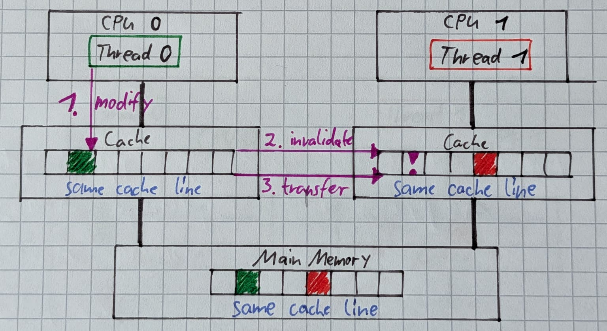

# Exam Assignment 28.10.2026

## Task 1
> What causes false sharing? Describe it visually by creating your own graphic.

False sharing occurs when threads on different processors modify variables packed into the same cache line. When one thread modifies a variable, the other thread's cache line becomes invalid, necessitating a memory update to maintain cache coherence.



The illustration shows two processors, each with its own cache and one active thread. Both threads modify different variables (green and red) that reside in the same cache line. First (1), Thread 0 modifies the green variable in its cache. Second (2), the cache coherence requirement invalidates the cache line in CPU 1's cache. Last (3), the cache line must be updated in CPU 1's cache, potentially from CPU 0's cache or main memory. Analogously, if Thread 1 modifies the red variable.

## Task 2
> Read the paper [There’s plenty of room at the Top: What will drive computer performance after Moore’s law?](../../assets/reading/leiserson20_theres-plenty-of-room-at-the-top-what-will-drive-computer-performance-after-moores-law.pdf)
> - Explain in detail the figure Performance gains after Moore’s law ends. (on the first page)

Read time: ~60min

According to Moore's law, the number of transistors on a chip doubles approximately every two years, resulting in growth in computing performance. However, after many decades, this trend is reaching physical limits. In order to continue growing, software, algorithms and hardware architecture must be improved and optimised.

The image shows the **Computing Stack** with its two main layers. The bottom layer comprises, for example, semiconductor technology and progress in transistor density (miniaturization). Unfortunately, this will no longer deliver the predictable performance gains promised by Moore's law. The top layer is important in the post-Moore's law era (now). This includes software, algorithms, and hardware architecture. The paper argues that this layer is already the driving force behind growth in computer performance.

One opportunity is **software**, or more precisely, software performance engineering. In the past, short development time was often more important than execution time in order to deliver quickly. This resulted in a lot of inefficient software, often called "software bloat." Now, optimizing the execution speed of existing (and new) programs is crucial. Another aspect is to adapt software to specific hardware features, such as parallel processing, vector units, and memory hierarchies. 

Another opportunity lies in **algorithms**. Rather than optimizing existing algorithms, new, more efficient ones can be developed, requiring less computational power for example. Besides the possibility of improving from research on old problems, the paper lists three areas of algorithmic research that can lead to significant progress: (i) attacking new problems, (ii) addressing scalability concerns, and (iii) tailoring algorithms to take advantage of modern hardware. Therefore, the paper proposes moving away from thinking theoretically with the random-access machine model, which can only perform one operation at a time and the same cost for all memory accesses. Modern machines often have multiple processing cores, vector units, and the ability to perform multiple operations per clock cycle. These are all possibilities that should be taken into account.

The last part of the top layer of the figure is the **hardware architecture**. It brings the opportunity for hardware streamlining, meaning hardware functions can be implemented using fewer transistors and less silicon area. Consequently, more chip area can be allocated to additional cores operating in parallel. The paper mentions two main strategies for streamlining processors to use application parallelism. The first strategy is processor simplification, which replaces a complex processing core with a simpler core that uses fewer transistors. This reduces power consumption and saves area on the chip. The second strategy is domain specialization, which involves designing customized hardware for specific application domains. For example, GPUs are used for graphical processing and TPUs are used for machine learning.


## Task 3 (optional)
> Do the coding warmup on slide 20. (optional)

### Task 3.1
> Fix the race condition bug on page 13 with a std::mutex.

Fixed version of the π program with a std::mutex [task_03/race_condition_fixed.cpp](task_03/race_condition_fixed.cpp) (namespace std is used, so no need to prefix std::mutex with std::). `lock_guard<mutex> lock(pi_lock)` acquires the lock before updating `pi` and automatically releases it when leaving the scope, i.e. end of the parallel region.

### Task 3.2
> Reduce the runtime of the image denoising program on slide 16 by adding an appropriate schedule.

Added `schedule(dynamic)` to the `#pragma omp parallel for` directive in [task_03/unbalanced_workload_optimized.cpp](task_03/unbalanced_workload_optimized.cpp). This allows threads to dynamically take on new iterations of the loop as they finish their current work, which helps balance the workload among threads and reduces overall runtime.

```sh
$ g++ -fopenmp unbalanced_workload.cpp -o unbalanced_workload.exe                    
$ ./unbalanced_workload.exe 0.281045 seconds
$ g++ -fopenmp unbalanced_workload_optimized.cpp -o unbalanced_workload_optimized.exe
$ ./unbalanced_workload_optimized.exe 0.140485 seconds
```

### Task 3.3
> What schedule on slide 18 produces the following (bad) pattern?

Changed `schedule(static, 8)` to `schedule(static, 22)` in [task_03/schedule_clause.cpp](task_03/schedule_clause.cpp). The static schedule with a chunk size of 22 distributes the first 22 iterations to thread 0 and the remaining 10 iterations to thread 1, leaving threads 2 and 3 idle.

## Task 4
> Rewrite the program for estimating π from the last lecture (pi_numerical_integration.cpp ) so that it is  parallelized with the #pragma omp for construct.

**FYI**: Since I already did this for last week's assignment, I just copied it here. I already was familiar with the `#pragma omp for` construct and how to use it from previous lectures in my studies.

Added `#pragma omp parallel for reduction(+:sum)` to the for loop in [pi_numerical_integration_parallel.cpp](task_04/pi_numerical_integration_parallel.cpp)
- `parallel for`: Distributes iterations among threads
- `reduction(+:sum)`: Each thread gets its own copy of `sum` (initialized to 0.0) and at the end of the parallel region, all copies are aggregated into a single value using the `+` operator