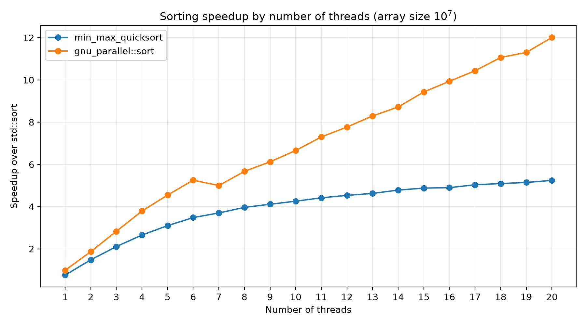
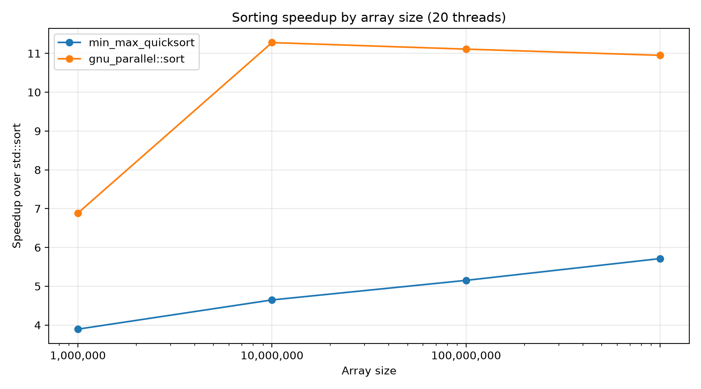

# Exam Assignment 11.11.2026

## Task 1
> Benchmark min_max_quicksort against std::sort and __gnu_parallel::sort. (you can adjust min_max_quicksort.cpp as necessary)

### Task 1.1
> - Provide details of your benchmarking environment, including the Operating System, RAM, CPU, and Compiler.

- **OS**: Pop!_OS 24.04 LTS
- **RAM**: 31 GiB (32 GB DDR5-6000 RAM CL30 Kit)
- **CPU**: 13th Gen Intel(R) Core(TM) i5-13600KF
    - Cores: 14 (6 Performance-cores, 8 Efficient-cores)
    - Threads: 20
    - L2 Cache: 20 MB
    - L3 Cache: 24 MB
- **Compiler**: ++ (Ubuntu 13.3.0-6ubuntu2~24.04.1) 13.3.0

### Task 1.2
> - Create a graph where the x-axis represents the number of threads and the y-axis displays the relative speedup over std::sort. (use an array size of at least $10^7$)

Benchmark program: [min_max_quicksort_thread_num.cpp](./task_01/min_max_quicksort_thread_num.cpp)

```sh
$ g++ -Ofast -march=native -fopenmp min_max_quicksort_thread_num.cpp -o min_max_quicksort_thread_num.exe
$ ./min_max_quicksort_thread_num.exe                                                                    
Threads: 1
        std::sort time: 0.514093 s
        min_max_quicksort time: 0.679125 s
        speedup over std::sort: 0.756994
        __gnu_parallel::sort time: 0.522763 s
        speedup over std::sort: 0.983415
Threads: 2
        std::sort time: 0.513842 s
        min_max_quicksort time: 0.347496 s
        speedup over std::sort: 1.4787
        __gnu_parallel::sort time: 0.275552 s
        speedup over std::sort: 1.86477
Threads: 3
        std::sort time: 0.512465 s
        min_max_quicksort time: 0.243104 s
        speedup over std::sort: 2.108
        __gnu_parallel::sort time: 0.181015 s
        speedup over std::sort: 2.83106
Threads: 4
        std::sort time: 0.514022 s
        min_max_quicksort time: 0.193645 s
        speedup over std::sort: 2.65445
        __gnu_parallel::sort time: 0.135548 s
        speedup over std::sort: 3.79219
Threads: 5
        std::sort time: 0.514145 s
        min_max_quicksort time: 0.165838 s
        speedup over std::sort: 3.10027
        __gnu_parallel::sort time: 0.113009 s
        speedup over std::sort: 4.54961
Threads: 6
        std::sort time: 0.513325 s
        min_max_quicksort time: 0.147458 s
        speedup over std::sort: 3.48117
        __gnu_parallel::sort time: 0.0977119 s
        speedup over std::sort: 5.25346
Threads: 7
        std::sort time: 0.513018 s
        min_max_quicksort time: 0.138625 s
        speedup over std::sort: 3.70076
        __gnu_parallel::sort time: 0.102641 s
        speedup over std::sort: 4.99816
Threads: 8
        std::sort time: 0.515446 s
        min_max_quicksort time: 0.130052 s
        speedup over std::sort: 3.96337
        __gnu_parallel::sort time: 0.0908895 s
        speedup over std::sort: 5.67113
Threads: 9
        std::sort time: 0.514599 s
        min_max_quicksort time: 0.125118 s
        speedup over std::sort: 4.11289
        __gnu_parallel::sort time: 0.084031 s
        speedup over std::sort: 6.12391
Threads: 10
        std::sort time: 0.512749 s
        min_max_quicksort time: 0.120435 s
        speedup over std::sort: 4.25746
        __gnu_parallel::sort time: 0.0770125 s
        speedup over std::sort: 6.658
Threads: 11
        std::sort time: 0.513273 s
        min_max_quicksort time: 0.116197 s
        speedup over std::sort: 4.41725
        __gnu_parallel::sort time: 0.070295 s
        speedup over std::sort: 7.30169
Threads: 12
        std::sort time: 0.512628 s
        min_max_quicksort time: 0.113077 s
        speedup over std::sort: 4.53345
        __gnu_parallel::sort time: 0.0659766 s
        speedup over std::sort: 7.76985
Threads: 13
        std::sort time: 0.513375 s
        min_max_quicksort time: 0.111009 s
        speedup over std::sort: 4.62462
        __gnu_parallel::sort time: 0.0618941 s
        speedup over std::sort: 8.29442
Threads: 14
        std::sort time: 0.514869 s
        min_max_quicksort time: 0.10762 s
        speedup over std::sort: 4.78413
        __gnu_parallel::sort time: 0.0590415 s
        speedup over std::sort: 8.72047
Threads: 15
        std::sort time: 0.515675 s
        min_max_quicksort time: 0.105732 s
        speedup over std::sort: 4.87718
        __gnu_parallel::sort time: 0.0546719 s
        speedup over std::sort: 9.43217
Threads: 16
        std::sort time: 0.514954 s
        min_max_quicksort time: 0.105128 s
        speedup over std::sort: 4.89836
        __gnu_parallel::sort time: 0.0518183 s
        speedup over std::sort: 9.9377
Threads: 17
        std::sort time: 0.513985 s
        min_max_quicksort time: 0.102077 s
        speedup over std::sort: 5.03526
        __gnu_parallel::sort time: 0.049249 s
        speedup over std::sort: 10.4365
Threads: 18
        std::sort time: 0.513499 s
        min_max_quicksort time: 0.100829 s
        speedup over std::sort: 5.09275
        __gnu_parallel::sort time: 0.046412 s
        speedup over std::sort: 11.0639
Threads: 19
        std::sort time: 0.513472 s
        min_max_quicksort time: 0.0998088 s
        speedup over std::sort: 5.14455
        __gnu_parallel::sort time: 0.0454207 s
        speedup over std::sort: 11.3048
Threads: 20
        std::sort time: 0.513041 s
        min_max_quicksort time: 0.0978531 s
        speedup over std::sort: 5.24298
        __gnu_parallel::sort time: 0.0427073 s
        speedup over std::sort: 12.013
```

Plot program: [plot.py](./task_01/plot.py)



### Task 1.3
> - Construct another graph with the x-axis denoting the array size and the y-axis illustrating the relative speedup over std::sort. (use all CPU threads)

Benchmark program: [min_max_quicksort_array_size.cpp](./task_01/min_max_quicksort_array_size.cpp)

```sh
g++ -Ofast -march=native -fopenmp min_max_quicksort_array_size.cpp -o min_max_quicksort_array_size.exe
(base) fhofer@pop-os ~/ddrive/dev/fsu/algorithm-engineering-fsu-2026/answers/assignment_04/task_01 (main*?) $ ./min_max_quicksort_array_size.exe                                                                    
Array size: 100000
        std::sort time: 0.00426746 s
        min_max_quicksort time: 0.00109572 s
        speedup over std::sort: 3.89468
        __gnu_parallel::sort time: 0.000619753 s
        speedup over std::sort: 6.88574
Array size: 1000000
        std::sort time: 0.0451599 s
        min_max_quicksort time: 0.00971664 s
        speedup over std::sort: 4.64768
        __gnu_parallel::sort time: 0.00400426 s
        speedup over std::sort: 11.278
Array size: 10000000
        std::sort time: 0.522239 s
        min_max_quicksort time: 0.10137 s
        speedup over std::sort: 5.1518
        __gnu_parallel::sort time: 0.0470077 s
        speedup over std::sort: 11.1096
Array size: 100000000
        std::sort time: 5.98741 s
        min_max_quicksort time: 1.04798 s
        speedup over std::sort: 5.71326
        __gnu_parallel::sort time: 0.54678 s
        speedup over std::sort: 10.9503
```

Plot program: [plot.py](./task_01/plot.py)



### Task 1.4
> - Explain any patterns or trends observed in the graphs, and offer potential reasons for these findings.

#### Thread Number vs. Speedup

At the beginning, with only one thread, both `min_max_quicksort` and `gnu_parallel::sort` have a speedup of less than 1 compared to `std:sort`. This indicates that the overhead of using OpenMP for parallelization is not worth for a single thread.

As soon as two threads are used, both `min_max_quicksort` and `gnu_parallel::sort` show a speedup over `std:sort`.
As the number of threads increases further, both `min_max_quicksort` and `gnu_parallel::sort` show an increase in speedup and defenetly outperform `std:sort` more and more.

However, the speedup of `gnu_parallel::sort` is consistently higher than that of `min_max_quicksort`, which indicates that `gnu_parallel::sort` is more efficient, probably due to more optimized implementation.
Also, the speedup of `min_max_quicksort` seems to plateau after 14 threads, while `gnu_parallel::sort` continues to grow linearly. The poor scaling of `min_max_quicksort` indicates that it is not utilizing the available threads efficiently, maybe due to bad load balancing or overhead in managing threads.

An interesting observation is that the speedup of `gnu_parallel::sort` has a small dip between the 6th and 7th thread. My assumption is that until the 6th thread, only one thread on each performance core is used. Afterwards, the 7th thread is scheduled either on a hyperthread of a performance core or on one of the efficient cores, which are slower than utilizing one thread on a performace core. Therefore the speedup scales afterwards (7th+ thread) again linarly.

#### Array Size vs. Speedup

I tested array sizes of $10^6, 10^7, 10^8$ and $10^9$. Everything below $10^6$ was too fast to measure accurately and for everything above $10^9$ the memory became the bottleneck.

The speedup of both `min_max_quicksort` and `gnu_parallel::sort` over `std:sort` is in all cases higher than 1, which means that prallelization is worth it for all tested array sizes. However, the speedup of `gnu_parallel::sort` is with distances higher than that of `min_max_quicksort`, which indicates that `gnu_parallel::sort` is more efficient, probably due to more optimized implementation, load balancing and less overhead on thread management.

`gnu_parallel::sort` has its peak speedup at an array size of $10^7$ probably the best trade-off between thread management and data to process. After that, the speedup decreases again. Reasons could be that the cache is not utilized efficiently anymore, or that the overhead of managing threads becomes more significant for larger array sizes since it needs more recursive calls on the divide and conquer algorithm.

`min_max_quicksort` on the other hand scales over the four tested array sizes nearly linear. However, the linear steps are small and the overall speedup is much lower than that of `gnu_parallel::sort`. Therefore it might have a better linear scaling on array sizes but since the overall speedup is much lower, it is no competitor to `gnu_parallel::sort`.

## Task 2
> Read What every systems programmer should know about concurrency.
> - https://assets.bitbashing.io/papers/concurrency-primer.pdf
> - Discuss two things you find particularly interesting.

### Torn Reads and Writes

The first thing that stood out to me was the concept of torn reads and writes in the context of atomicity. I was already familiar with atomic operations from previous courses, but had only encountered them in the context of multithreading. According to the paper, atomic means that an operation cannot be divided into smaller parts and must therefore be performed as a single, whole operation. Or in other words, it either happens completely or not at all. This concept is particularly important in multithreaded programmes because it ensures that one thread cannot read or write data that has not yet been fully processed by another thread. The paper illustrates this with an example where two threads share a counter variable. One thread processes files and increments the counter by one for each completed file. The other thread is responsible for periodically updating a progress bar based on the counter's value. If the counter is a 64-bit integer on a 32-bit machine, reading or writing it may require two separate operations. Consequently, the second thread could read the counter while the first thread is only halfway through updating it, resulting in an inconsistent value. This problem is known as torn read and write. Using atomic operations prevents this problem by ensuring that the counter is always read or written as a complete value.

### Sequential Consistency

The second topic I chose to discuss is sequential consistency. Sequential consistency means that the result of any execution is the same as if the operations of all threads were executed in some sequential order, and the operations of each individual thread appears in the order specified by the program. This makes it easier to reason about multithreaded programs, since the programmer can rely on a consistent ordering of memory operations. However, the compiler and CPU may reorder instructions to improve performance. Therefore, enforcing sequential consistency can require additional memory barriers, for example on weakly ordered hardware architectures such as ARM. These barriers restrict some optimizations and may introduce performance overhead. What I found particularly interesting is that sequential consistency is not always necessary to ensure correct synchronization between threads. The paper illustrates this using a spinlock that protects a critical section. While memory operations inside the critical section must not be moved outside of it, operations from outside may be moved inside without causing problems. Therefore, instead of using sequential consistency, the spinlock can use acquire ordering when locking and release ordering when unlocking. This provides the necessary synchronization while allowing the compiler and CPU to perform additional optimizations.